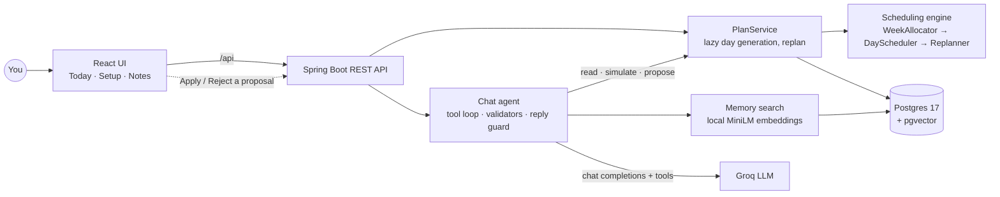

# Life Organizer

[](https://github.com/razvan001/life-organizer/actions/workflows/ci.yml)

A personal day planner with an AI assistant that is only allowed to *propose*.

Paste your goals and your constraints once. A deterministic scheduling engine builds a time-blocked plan for
today and re-plans when the day changes (done, postponed, cancelled, something new came up). On top of it sits a
tool-calling LLM agent you can talk to ("padel got canceled and I'm tired", "review my week"): it reads your
plan, your week and your own notes, simulates changes with the real engine, and shows a proposal card. Nothing
changes until you press **Apply**.

## What is in it

- **Scheduling engine** — plain Java, no framework. Weekly quotas ("Learning: 5h/week", "Gym: 4x/week") are
  split across goals by priority and deadline, placed into free time, and re-planned event by event.
- **Chat agent with tools** — a server-side tool-calling loop (Groq, `openai/gpt-oss-120b`). The agent can read,
  search memory and simulate; the only thing that writes is the user applying a proposal.
- **Weekly review** — one button: the agent looks at what was planned, done, cancelled and postponed, proposes
  new goal priorities, and on Apply the untouched days later in the week are planned again.
- **Memory (RAG)** — your notes and a one-line summary of every past day, embedded locally (all-MiniLM-L6-v2,
  in-process, no API key) and searched with pgvector. "Tired after a workout" finds "after gym I can't focus".
- **Guard rails around the model** — every proposed event is validated and simulated before it becomes a card;
  a reply that claims a change without a recorded proposal is sent back for correction; rate limits are waited
  out instead of failing the turn.
- **Tests** — about 400 backend tests (unit, slice, and end-to-end against a real Postgres via Testcontainers)
  and about 150 frontend tests. No test needs an API key: the model is scripted.

## How it fits together



Three decisions shape the code:

1. **The engine decides, the model suggests.** Time is placed by deterministic code that can be unit-tested.
   The LLM never edits the plan; it emits the same events the buttons do, and the engine simulates them first.
2. **Model output is never trusted.** Block ids, goal ids, priorities and event shapes are checked server-side;
   a problem goes back to the model as a tool error it can fix, never to the user as a broken plan.
3. **Days are generated lazily and kept.** A day is planned the first time it is needed and then stored, so the
   plan you acted on does not shift under you when goals change.

## Tech stack

| Layer | Choice |
|---|---|
| Backend | Java 21, Spring Boot 4.1, Spring Data JPA, Flyway |
| Database | Postgres 17 with pgvector (HNSW cosine index) |
| AI | Groq chat completions with function tools (plain `RestClient`, no SDK); langchain4j ONNX MiniLM for embeddings |
| Frontend | React 19, TypeScript, Vite, React Router; no state or data-fetching library |
| Tests | JUnit 5, Testcontainers, MockMvc, Vitest, Testing Library |
| CI | GitHub Actions: backend suite, frontend tests and type-checked build |

**Status:** engine, persistence and REST API, React UI, RAG memory, the chat agent and the weekly review are
done. Not built: login (it is a single-user app for localhost), calendar sync, and automatic conflict resolution.

The features were designed and built one slice at a time with written specs and task plans (see
[Design documents](#design-documents)), using Claude Code as a pair programmer; every change was reviewed before
it was committed.

## What you need

- Java 21
- Docker Desktop (running) — for the local database and for the automated tests
- Node.js 22.12 or newer (tested with 24) — for the React UI

## Run it

```bash
# 1. start Postgres (pgvector image, port 5432)
docker compose up -d

# 2. start the backend on http://localhost:8080
cd backend
./mvnw spring-boot:run          # Windows PowerShell: .\mvnw.cmd spring-boot:run
```

Stop with `Ctrl+C`; `docker compose down` stops the database (add `-v` to wipe its data).
If port 5432 is already in use, stop your local Postgres or change the port mapping in `docker-compose.yml`
and set `DB_URL` accordingly.

## Run the UI

With the database and the backend running (previous section), in a second terminal:

```bash
cd frontend
npm install        # once
npm run dev        # http://localhost:5173
```

Open http://localhost:5173.

1. **Setup** — the two boxes are prefilled with an example. Press **Parse**, adjust priorities or deadlines
   if you like, press **Save**. Lines the parser did not understand are listed as "not understood" and are ignored;
   edit the text and press Parse again. **Use example text** puts the example back into the two boxes.
2. **Today** — your timeline. **Done** / **Postpone** (optionally with a reason) / **Cancel** apply to goal blocks
   and ad-hoc events; a toast shows what the replanner changed. A block postponed three times is flagged.

How it fits together: `npm run dev` starts Vite, a development web server. The browser talks only to Vite;
Vite forwards every `/api/...` request to the Spring Boot backend on port 8080 (`frontend/vite.config.ts`),
so there is no CORS configuration.

Other commands (run inside `frontend/`):

| Command | What it does |
|---|---|
| `npm test` | runs the Vitest tests once (`npm run test:watch` re-runs on change) |
| `npm run build` | type-checks with `tsc`, then writes the production bundle to `frontend/dist` |

## Try the API

```bash
# 1. turn your pasted text into structured data (nothing is saved yet)
curl -s -X POST localhost:8080/api/setup/parse -H "Content-Type: application/json" -d '{
  "goalsText": "Goals\n├── Career\n│   ├── Claude certification\n│   └── Azure AI\n├── Health\n│   └── Gym\n└── Social\n    └── Dating / events\n",
  "constraintsText": "Work: 08:30-17:00\nGym: 4x/week\nSleep: 23:30-07:00\nLearning: 5h/week\nSocial: 2 evenings/week\n"
}' > parsed.json

# 2. save it (the parse response can be sent back as-is)
curl -s -X PUT localhost:8080/api/setup -H "Content-Type: application/json" -d @parsed.json

# 3. see today's plan
curl -s localhost:8080/api/plan/today

# 4. act on it - use a block id from step 3
curl -s -X POST localhost:8080/api/plan/today/events -H "Content-Type: application/json" \
  -d '{"type":"MARK_DONE","blockId":"<id>"}'
curl -s -X POST localhost:8080/api/plan/today/events -H "Content-Type: application/json" \
  -d '{"type":"POSTPONE_BLOCK","blockId":"<id>","reason":"not in the mood"}'
```

(On Windows PowerShell use `curl.exe` instead of `curl`, and put the JSON in a file with `-d @file.json`.)

Restart the backend and call `GET /api/plan/today` again: your done/postponed state is still there.

## API

| Method | Path | Purpose |
|---|---|---|
| POST | `/api/setup/parse` | goals text + constraints text → structured setup + warnings (no save) |
| PUT | `/api/setup` | save the (possibly edited) setup; returns what was stored |
| GET | `/api/setup` | the stored setup |
| GET | `/api/plan/today` | today's blocks (generated on first request, then persisted) |
| POST | `/api/plan/today/events` | `MARK_DONE`, `POSTPONE_BLOCK`, `CANCEL_BLOCK`, `SET_ENERGY`, `ADD_ADHOC` |
| GET | `/api/config` | `{aiEnabled, ragEnabled}` - `aiEnabled` reflects whether `GROQ_API_KEY` is configured; `ragEnabled` is true when the local embedding model is loaded (always, unless removed) |
| GET | `/api/assistant/chat?date=` | a day's chat thread (default today) |
| GET | `/api/assistant/chat/days` | days that have a chat thread, newest first |
| POST | `/api/assistant/chat/messages` | `{text}` → runs the planning agent on today's thread, returns its reply (and a proposal, if any) |
| POST | `/api/assistant/chat/messages/{id}/apply` | apply that message's pending proposal (today's plan changes, or new goal priorities plus re-planning of untouched later days) |
| POST | `/api/assistant/chat/messages/{id}/reject` | reject that message's pending proposal |
| POST | `/api/setup/extract` | turn a free-form brain dump into a goals/constraints preview (not saved; needs `GROQ_API_KEY`) |
| POST | `/api/plan/today/events/batch` | apply several plan events at once |
| GET | `/api/notes` | list notes, newest first |
| POST | `/api/notes` | create a note `{title, body}` (201) |
| PUT | `/api/notes/{id}` | update a note |
| DELETE | `/api/notes/{id}` | delete a note (204) |
| GET | `/api/memory/search?q=&k=&source=` | semantic search over notes and past days (`k` 1-20, default 8; `source` NOTE or DAY) |

Times are `"HH:mm"`, dates `"yyyy-MM-dd"`. A goal's `deadline` is optional: send `deadline: null` (or omit it,
or send an empty string) for no deadline. Errors are RFC 7807 `application/problem+json`
(`404` no setup yet, `409` proposal not available, `422` unknown block id, `400` invalid request, `502` assistant unavailable,
`503` AI features are not configured).

## Assistant (optional)

Set `GROQ_API_KEY` before starting the backend to turn on the chat at the bottom of Today (and the brain-dump
box on the Setup page); get a free key at https://console.groq.com:

```bash
export GROQ_API_KEY=gsk_...      # PowerShell: $env:GROQ_API_KEY="gsk_..."
cd backend && ./mvnw spring-boot:run
```

Talk to it like "padel got canceled" or "I'm tired, what should I drop today?". The agent looks at today's plan,
the rest of the week, your goals and your memory (notes and past days) with tools, can simulate changes before
suggesting them, and proposes one change set per message. Press Apply to make the change or Reject to discard
it; the assistant never changes the plan itself. Press **Review my week** for a weekly review: the agent looks
at what was planned, done, cancelled and postponed this week and proposes new goal priorities; Apply saves them
and re-plans the days later this week that you have not touched yet (today and days you acted on stay as they
are). Conversations are saved one per day; earlier days can be
viewed under "Earlier chats". Without the key, `GET /api/config` reports `aiEnabled:false` and the chat does
not appear - every other feature is unaffected. The model used is `openai/gpt-oss-120b` (configurable via the
`app.ai.model` property).

Groq's free tier allows 8,000 tokens per minute for this model, which is about what one chat turn uses. When the
limit is hit the backend waits the few seconds Groq asks for and retries (up to three attempts per call, never
more than 30 seconds each), so a reply can take a while; if it still fails the chat says the assistant is rate
limited. The backend log shows the tokens each call used (`Groq usage: ...`). The agent asks the model for low
reasoning effort to save tokens (`app.ai.reasoning-effort`: `low`, `medium`, `high`, or empty for a model that
does not support it).

## Memory (RAG)

The Notes page stores your own notes and searches them together with a one-line summary of every past day
(what you did, postponed or cancelled, and why). Search is semantic: "tired after a workout" finds a note
that says "after gym I can't focus on study".

Embeddings come from all-MiniLM-L6-v2 (quantized) running inside the backend. No API key, no network.
Vectors live in Postgres through the pgvector extension (table `memory_chunk`, HNSW cosine index).
Past days are indexed when the backend starts and every night at 00:05.

## How planning works

- **Goals** get a priority (1-5); each weekly quota (e.g. "Learning: 5h/week") is split across its goals by
  priority, with a boost for goals whose deadline is close.
- A day is **generated the first time it is requested** and then stored. Editing your setup later never
  rewrites a day that was already generated. Generation is lazy in two more places: a postpone can generate
  and persist the remaining days of that week while it looks for room, and an ad-hoc event with a future
  date generates that day.
- **Postpone** moves a block to a later free slot today, else to the next day with room this week. The
  third postpone flags the block. Fixed blocks, routine blocks (Dinner / break, Wind down) and completed
  blocks are never postponed, and an already-postponed or cancelled block cannot be postponed again. If no
  slot is free this week the plan is left unchanged and the response carries a "No room this week" note.

## Known limitations

- Editing the setup mid-week can double-count or skip a little quota for the current week (already-done work
  is not yet subtracted from the weekly allocation).
- A postponed block has no notion of "the past" yet (the engine has no clock).
- Cancelling a block frees its slot; it is not automatically refilled with the next-best task.
- `SET_ENERGY` is accepted but does not change the plan yet.

## Tests

```bash
cd backend && ./mvnw test    # needs Docker running; spins up a throwaway Postgres per test class
# Windows PowerShell: cd backend; .\mvnw.cmd test

cd frontend && npm test      # Vitest, no backend needed
cd frontend && npm run build # type-check + production bundle
```

The same three commands run on every push and pull request (`.github/workflows/ci.yml`).

## Design documents

Each feature has a design spec and a task plan, written before the code:

- [`docs/superpowers/specs/`](docs/superpowers/specs/) — design specs: the original design, the backend and UI,
  natural-language commands, brain-dump extraction, RAG memory, the chat agent, the weekly review
- [`docs/superpowers/plans/`](docs/superpowers/plans/) — the implementation plan for each of them

The Phase 2 documents describe an earlier version of the assistant built on another provider; the backend was
later moved to Groq and the one-shot command box was replaced by the chat agent.
